# mini-btc

A Bitcoin node written in .NET 10 that follows a Bitcoin Core **regtest** network and
**re-validates every block and transaction with its own consensus code**, built with
Domain-Driven Design. Around it: a block explorer with live updates, a browser wallet that signs
transactions in JavaScript, a Python wallet and miner, and a faucet, all moving real regtest coins.

The node holds **no private keys**. It validates, stores and relays; wallets are clients of its API.

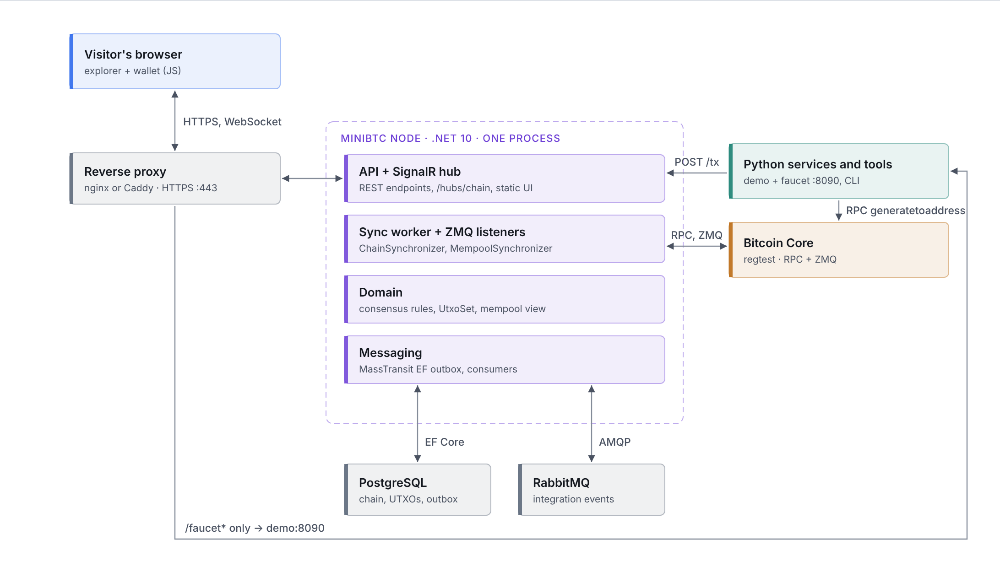

## What it shows

- **Consensus in our own code.** Header (proof of work, builds on tip, merkle root), block
  structure, `CheckTransaction`, inputs (exist, unspent, coinbase maturity, value balance), P2PKH
  signatures (ECDSA, strict DER) and the coinbase amount. Reject codes are Bitcoin Core's own
  reject reasons, e.g. `bad-txnmrklroot`, `bad-txns-inputs-missingorspent`.
- **Two implementations, one chain.** The parity check compares our tip, UTXO set and address
  balances with Core's `gettxoutsetinfo` and `scantxoutset`.
- **Reorgs.** Blocks are disconnected newest first from stored undo data until our tip is back on
  Core's active chain.
- **A broadcast gateway.** `POST /tx` checks a transaction against our UTXO set and mempool view
  before Core sees it; a rejection says whether the node or Core refused it.
- **Reliable events.** Each block is committed with its UTXO changes and an outbox row in one
  database transaction (MassTransit EF outbox → RabbitMQ → SignalR), so no one hears about a block
  that is not stored.

## Stack

| Part | Technology |
| --- | --- |
| Node | .NET 10, ASP.NET Core, EF Core + PostgreSQL, MassTransit + RabbitMQ, SignalR, NetMQ (ZMQ) |
| Domain building blocks | [Patterns.DDD](https://www.nuget.org/packages/Patterns.DDD): aggregates, `Result`/`Error`, rules, outbox |
| Explorer and browser wallet | Plain HTML, CSS and JavaScript modules, no build step; `@noble/secp256k1` for signing |
| Wallet, miner, demo, faucet | Python 3.13 (`coincurve`), managed with `uv` |
| Reference node | Bitcoin Core 30, regtest, RPC + ZMQ |
| Deployment | Docker Compose behind a reverse proxy (nginx or Caddy) with HTTPS |

## Solution layout

- `src/MiniBtc.Domain`: wire format, hashing, consensus rules, UTXO set, mempool (no I/O)
- `src/MiniBtc.Application`: use cases: chain sync, mempool mirror, broadcast, explorer queries, parity
- `src/MiniBtc.Infrastructure`: PostgreSQL, Bitcoin Core RPC, ZMQ, messaging
- `src/MiniBtc.Api`: REST endpoints, SignalR hub, explorer and wallet UI (`wwwroot`)
- `py/`: Python wallet (keys, coin selection, signing), miner, demo traffic driver and faucet
- `tests/`: domain, application, infrastructure and integration tests (.NET), `tests/web` (JS)
- `deploy/`: one-server deployment notes

## Architecture

Every flow below is drawn from the code. Solid arrows are calls, dashed arrows replies, dotted
arrows asynchronous events. Lanes are colored by technology: purple for the .NET node, teal for
Python, blue for the browser, amber for Bitcoin Core, grey for infrastructure. The explorer has the
same diagrams under **Project → Architecture** (`/#/architecture`).

### Following Core

**01 · Block sync.** Core mines a block; the node fetches the raw bytes, validates them with its
own rules and commits the block, its UTXO changes, its undo data and an outbox row in one
transaction.

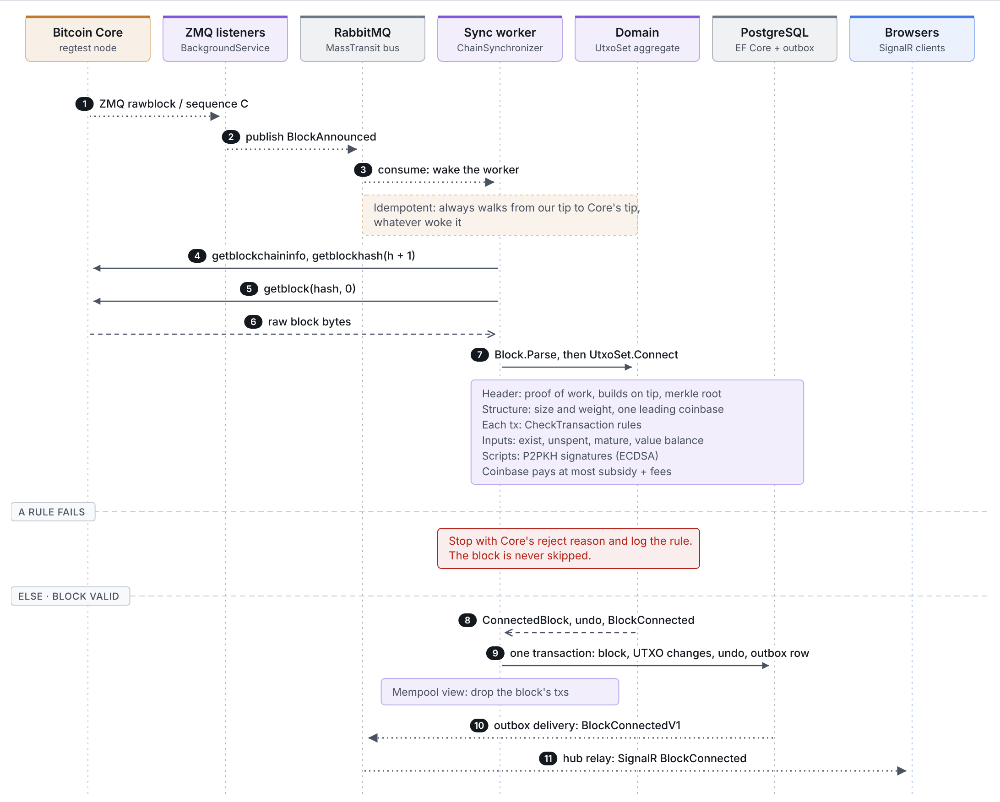

**02 · Reorg.** When Core switches branch, the node disconnects its own blocks from undo data until
its tip is on Core's chain, then connects Core's branch.

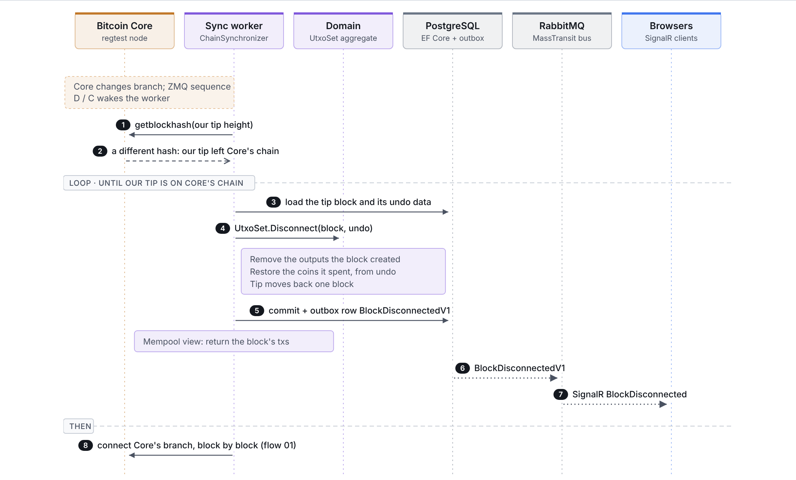

**03 · Mempool mirror.** A full reload at startup, then Core's ZMQ `sequence` events, ordered by
Core's mempool sequence number so nothing is applied twice.

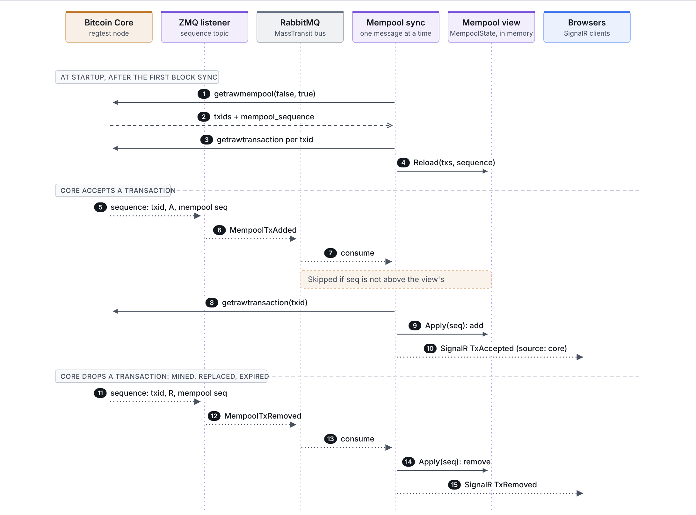

### Transactions

**04 · Broadcast gateway.** Every wallet sends signed transactions here. The node refuses double
spends (`bip125-replacement-disallowed`), immature coinbases and bad signatures before Core sees
them.

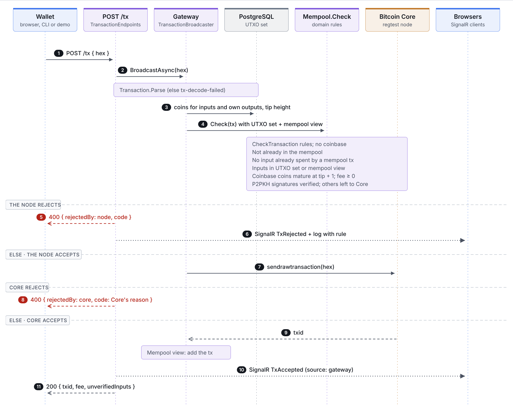

### Reading

**05 · Explorer queries.** Each query reads PostgreSQL in one `REPEATABLE READ` snapshot; pending
data comes from the in-memory mempool view.

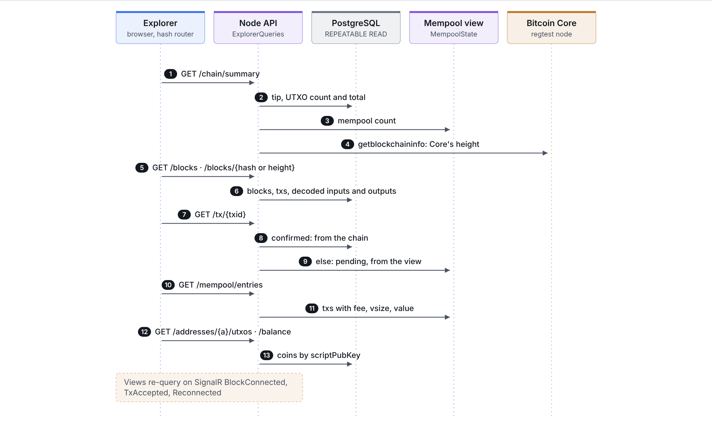

**06 · Parity check.** Our tip, UTXO count, total value and address balances against Core's.

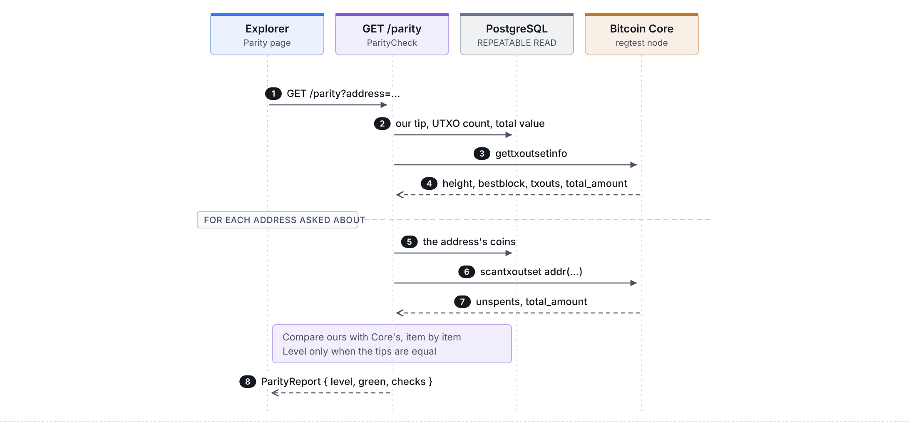

### Clients

**07 · Browser wallet.** The key is generated in the browser and stays in `localStorage`. Payments
are built and signed in JavaScript, byte for byte like the Python wallet, and sent to `POST /tx`.

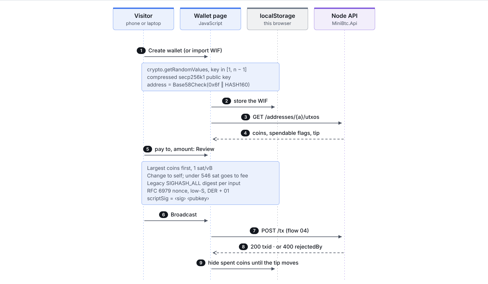

**08 · Faucet.** Gives a new wallet 5 regtest BTC. It runs in the Python demo service, which already
holds keys, so the node still holds none.

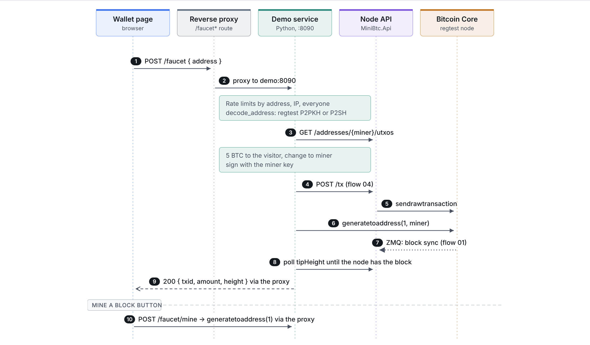

**09 · Demo traffic.** Keeps a public demo alive: payments every ~20 s, a block every ~60 s, and a
deliberate double spend now and then that the node refuses.

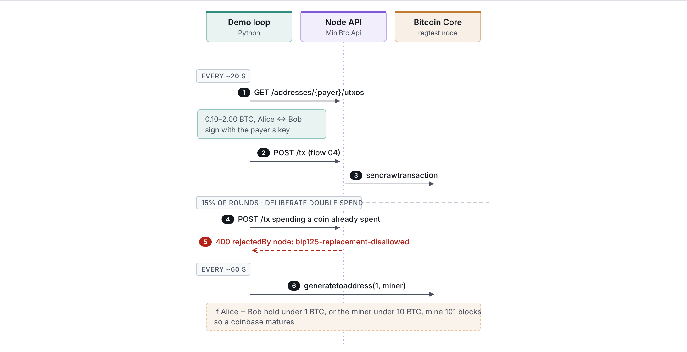

**10 · CLI wallet and miner.** The first clients of the node, used in development and tests.

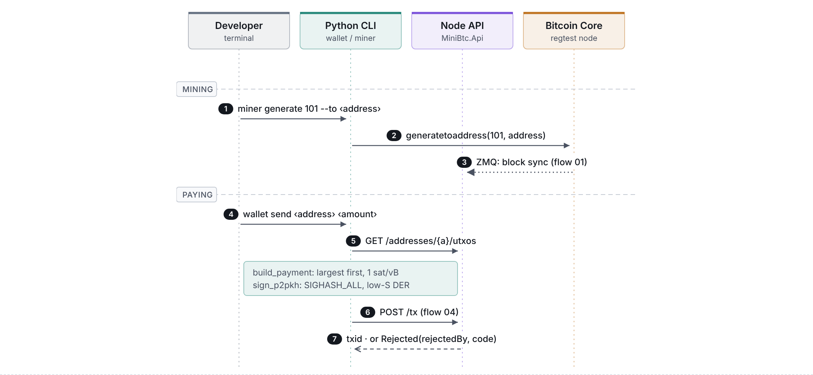

### Interfaces and events

| HTTP endpoint | Purpose |
| --- | --- |
| `POST /tx` | Broadcast gateway |
| `GET /addresses/{a}/utxos`, `/balance` | Coins with spendable flags; balance |
| `GET /chain/summary` | Tip, UTXO stats, Core's height |
| `GET /blocks`, `/blocks/{height or hash}` | Block list and detail |
| `GET /tx/{txid}` | Confirmed or pending transaction |
| `GET /mempool`, `/mempool/entries` | Mempool view |
| `GET /parity?address=…` | Node vs Core comparison |
| `GET /health` | Liveness and Core reachability |
| `/hubs/chain` | SignalR hub |
| `POST /faucet`, `/faucet/mine` | Demo service (Python), behind the reverse proxy |

| Event | Producer → consumer |
| --- | --- |
| `BlockAnnounced` | ZMQ listeners → sync worker (RabbitMQ) |
| `BlockConnectedV1`, `BlockDisconnectedV1` | `UtxoSet` via the EF outbox → hub relay (RabbitMQ) |
| `MempoolTxAdded`, `MempoolTxRemoved` | ZMQ `sequence` → mempool consumer (RabbitMQ) |
| `BlockConnected`, `BlockDisconnected` | Hub → browsers (SignalR) |
| `TxAccepted`, `TxRejected`, `TxRemoved` | Gateway or mempool consumer → browsers (SignalR) |

## Run it locally

Requirements: .NET 10 SDK, Docker, [uv](https://docs.astral.sh/uv/), optionally Node 22 for the JS tests.

```bash
cp .env.example .env            # optional: change credentials or ports
docker compose up -d --wait     # bitcoind (regtest), PostgreSQL, RabbitMQ
dotnet run --project src/MiniBtc.Api --urls http://127.0.0.1:5080
```

Open <http://127.0.0.1:5080>. `scripts/reset.sh` wipes everything and starts a fresh chain.

| Service | Host address | Purpose |
| --- | --- | --- |
| bitcoind RPC | 127.0.0.1:18443 | Catch-up sync, broadcast, parity checks |
| ZMQ rawblock / rawtx / sequence | 127.0.0.1:28332 / 28333 / 28336 | Live block and tx notifications |
| PostgreSQL | 127.0.0.1:5433 | Blocks, UTXO set, undo data, outbox/inbox |
| RabbitMQ | 127.0.0.1:5672, UI :15672 | Transport for domain events via the outbox |

### Tests

```bash
dotnet test MiniBtc.slnx                       # integration tests need the compose services
cd py && uv sync && uv run pytest              # -m "not integration" without services
node --test tests/web/wallet.test.mjs          # browser wallet crypto and signing
```

Tests use real Bitcoin data: the regtest genesis block, blocks captured from Core, Core's own test
vectors, and bitcoinjs-lib's signed transactions, which both wallets reproduce byte for byte.

### Wallet walkthrough

```bash
cd py && uv sync
uv run python -m wallet --wallet alice new
uv run python -m wallet --wallet bob new
uv run python -m miner generate 101 --to "$(uv run python -m wallet --wallet alice address)"
uv run python -m wallet --wallet alice balance
uv run python -m wallet --wallet alice send --to "$(uv run python -m wallet --wallet bob address)" --amount 10
```

Or open **Wallet** in the explorer: create a wallet in the browser, fund it with
`uv run python -m miner generate 101 --to <address>`, and pay a second wallet in another browser
profile.

### Double spend and reorg

```bash
uv run python -m wallet --wallet carol new
uv run python -m wallet --wallet alice send --to "$(uv run python -m wallet --wallet bob address)" --amount 10
# Spending the same coin again is refused by the node (bip125-replacement-disallowed) ...
uv run python -m wallet --wallet alice send --to "$(uv run python -m wallet --wallet carol address)" --amount 10
# ... and, sent straight to Core, by Core ("insufficient fee": a replacement must pay more).
uv run python -m wallet --wallet alice send --to "$(uv run python -m wallet --wallet carol address)" --amount 10 --direct

# Make Core drop its tip; the node disconnects the block from its undo data and follows.
scripts/btc-cli.sh invalidateblock "$(scripts/btc-cli.sh getbestblockhash)"
```

Rejections are logged with the rule as a structured `{Rule}` field; for one JSON object per line,
run with `Logging__Console__FormatterName=json`.

## Deployment

One server runs the whole stack with Docker Compose (`docker-compose.yml` +
`docker-compose.deploy.yml`): Core, PostgreSQL, RabbitMQ, the node and the Python demo service.
A reverse proxy terminates HTTPS, sends `/faucet*` to the demo service and everything else,
including the SignalR WebSocket, to the node. See [deploy/README.md](deploy/README.md).

Regtest coins only: this chain is private to the demo and its coins have no value.

## License

MIT, see [LICENSE](LICENSE).
